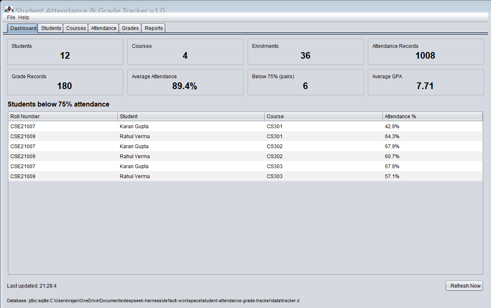
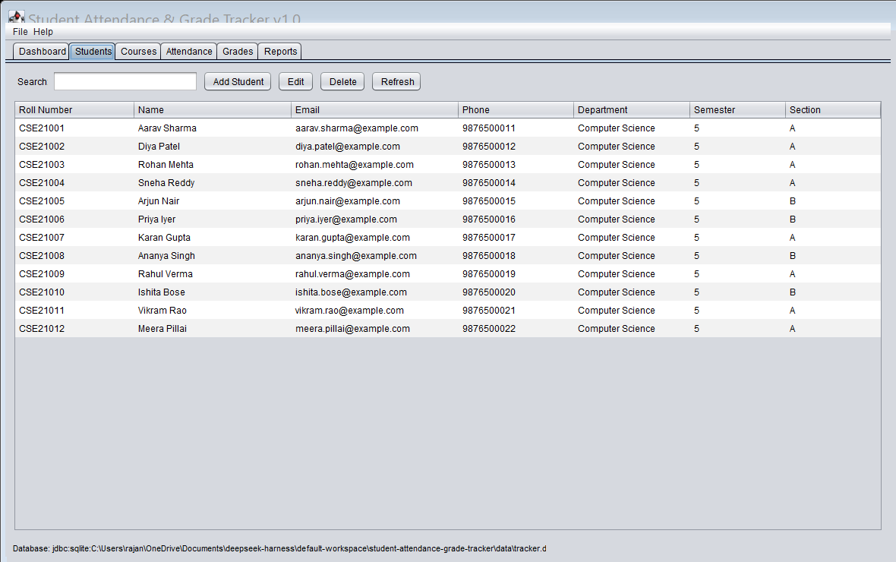
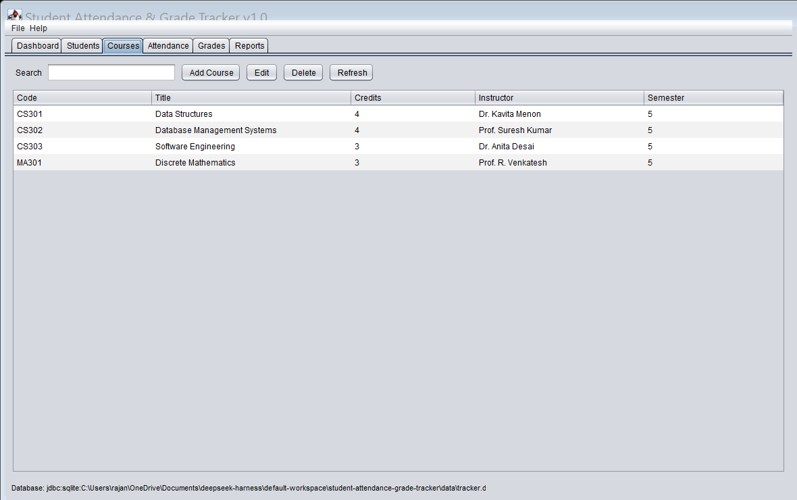
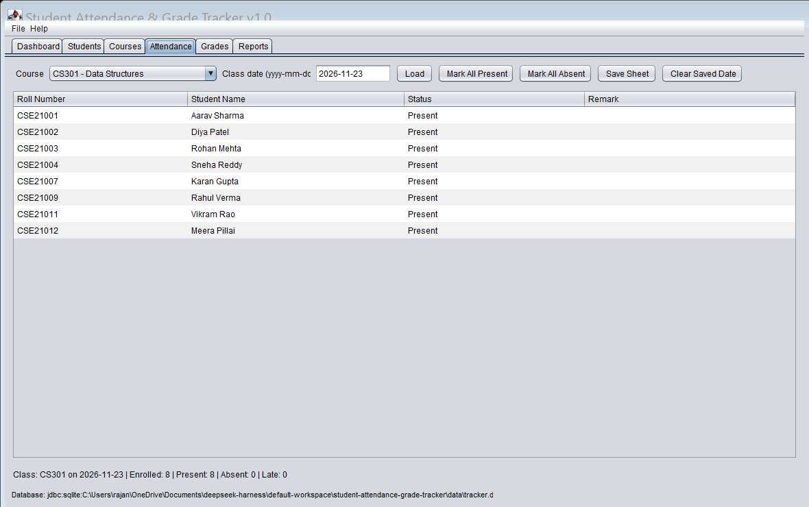
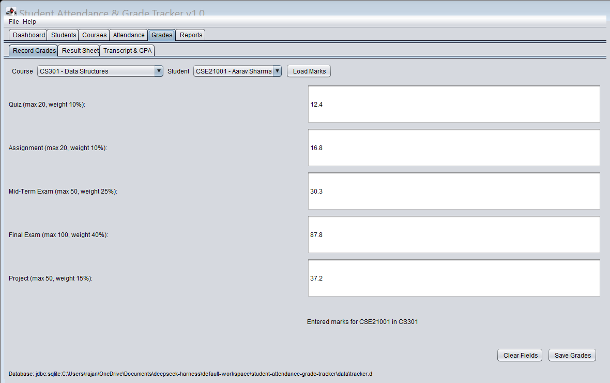
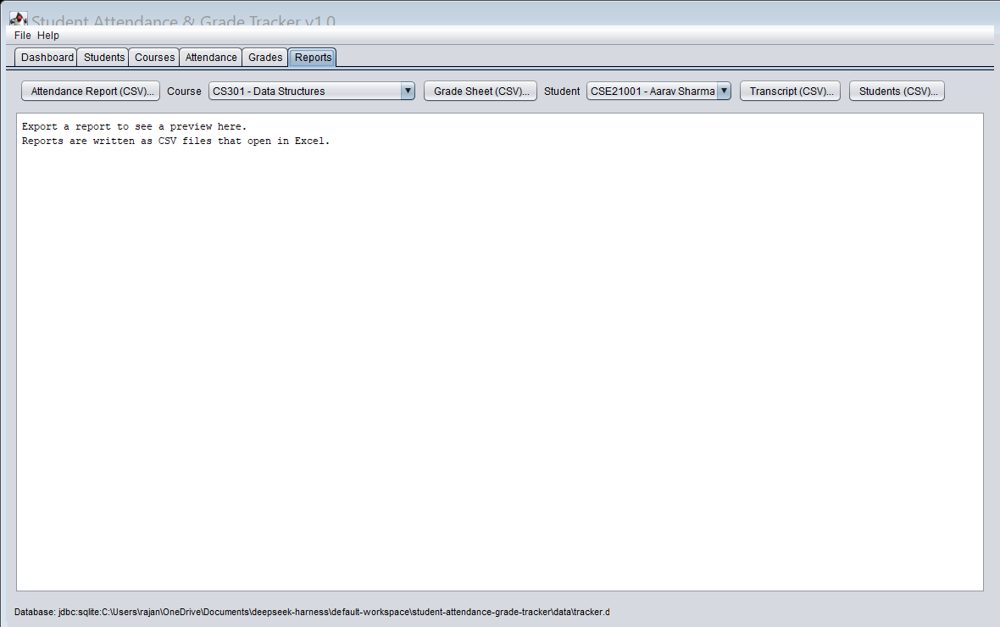

# Student Attendance & Grade Tracker

A complete **Java AAT (Assessment) project**: a desktop application for
teachers/faculty to manage **student attendance and grades**, built with
**Swing + JDBC (SQLite)** and every core/advanced Java concept required by
the AAT rubric.

> **Rubric alignment**: OOP & core concepts, Swing GUI, JDBC & database,
> advanced Java features & exception handling, testing, documentation.
> See [docs/ProjectReport.md](docs/ProjectReport.md) for the full report
> mapped week-by-week to the 11-week plan.

---

## 1. Features

| Module | What it does |
|---|---|
| **Dashboard** | Live statistics: students, courses, enrolments, attendance & grade records, average attendance, average GPA, plus the list of students below the 75% attendance threshold |
| **Students** | Live search, add / edit / delete with full input validation (roll number, email, phone, semester, section) |
| **Courses** | Live search, add / edit / delete courses (code, title, credits, instructor, semester) |
| **Attendance** | Pick a course + date, mark Present / Absent / Late for the whole class (bulk save in one **database transaction**), per-class summary, re-marking updates existing rows |
| **Grades** | Enter marks per assessment (Quiz, Assignment, Midterm, Final, Project) with weights; automatic **weighted percentage, letter grade (10-point scale) and GPA**; course result sheet and personal transcript |
| **Reports** | Export **CSV** reports (attendance summary, grade sheet, transcript, student list) with preview — files open directly in Excel |

## 2. Technology & concepts demonstrated

- **Java 17** (records, text blocks, switch expressions, `var`)
- **Swing GUI** — `JFrame`, `JTabbedPane`, tables (`AbstractTableModel`),
  combo-box editors, dialogs, menus, `SwingWorker` background refresh
- **JDBC + SQLite** (bundled `lib/sqlite-jdbc.jar`) — `PreparedStatement`
  everywhere, CRUD, joins, aggregates, **transactions with rollback**,
  upserts, foreign keys with cascade delete
- **OOP** — inheritance (`Person` → `Student`, `BaseDao` → DAOs),
  polymorphism, abstract classes, interfaces (`CrudRepository`, `Reportable`),
  overloading/overriding, encapsulation, `static` & `final`
- **Advanced Java** — collections, **generics** (bounded), **enums**,
  **file I/O** (CSV export), **user-defined exceptions**
  (`ValidationException`, `StudentNotFoundException`, `DatabaseException`),
  built-in exception handling (try-with-resources, multi-catch, chaining)

## 3. Project structure

```
student-attendance-grade-tracker/
├── lib/sqlite-jdbc.jar              ← bundled JDBC driver (no install needed)
├── sql/
│   ├── schema.sql                   ← SQLite DDL (also embedded in DatabaseManager)
│   └── schema-mysql.sql             ← optional MySQL 8 variant
├── src/com/aat/tracker/
│   ├── Main.java                    ← entry point
│   ├── model/                       ← entities, enums, records (OOP core)
│   ├── exception/                   ← user-defined exceptions
│   ├── util/                        ← Validator, Statistics, CsvExporter<T>
│   ├── db/                          ← DatabaseManager (singleton), SeedDemoData
│   ├── dao/                         ← CrudRepository<T,ID>, BaseDao, 5 DAOs
│   ├── service/                     ← Attendance/Grade/Report/Dashboard services
│   └── ui/                          ← MainFrame + 6 screens + dialogs + screenshots
├── test/com/aat/tracker/SmokeTest.java  ← 36 automated module checks
├── docs/
│   ├── ProjectReport.md             ← full AAT report (rubric-mapped)
│   └── screenshots/                 ← one PNG per screen
├── compile.bat / run.bat / test.bat / screenshots.bat   ← Windows scripts
├── run.sh / test.sh                 ← Linux/macOS scripts
└── pom.xml                          ← optional Maven build
```

## 4. How to run

**Requirements**: JDK 17+ (the SQLite driver is already bundled — no Maven,
no database server needed).

| Action | Windows | Linux/macOS |
|---|---|---|
| Compile + **run the app** | `run.bat` | `./run.sh` |
| Run the **36 smoke tests** | `test.bat` | `./test.sh` |
| Regenerate **screenshots** | `screenshots.bat` | — |
| Compile only | `compile.bat` | — |

On the first run the application creates `data/tracker.db` and seeds it with
demo data (12 students, 4 courses, 36 enrolments, 1008 attendance records,
180 grades) so you can demo everything immediately. Delete `data/tracker.db`
to re-seed. To skip seeding, run with `-Dtracker.seed=false`.

### Optional Maven build

```bash
mvn -q clean compile
java -cp "target/classes;lib/sqlite-jdbc.jar" com.aat.tracker.Main   # Windows
java -cp "target/classes:lib/sqlite-jdbc.jar" com.aat.tracker.Main   # Linux/macOS
```

## 5. Database design

Five tables with proper relationships and referential integrity:

```
students ──< enrollments >── courses
    │                           │
    └──< attendance              └──< grades
```

- `students` — roll_number unique; semester CHECK 1–8
- `courses` — course_code unique; credits CHECK 1–6
- `enrollments` — M:N link, UNIQUE (student, course), cascade delete
- `attendance` — one row per (student, course, class_date), status CHECK
- `grades` — one row per (student, course, assessment), weight CHECK 0–100

## 6. Screenshots

| Dashboard | Students | Courses |
|---|---|---|
|  |  |  |

| Attendance | Grades | Reports |
|---|---|---|
|  |  |  |

## 7. Grade & attendance rules

- **Attendance %** = (Present + Late) ÷ total classes × 100; students below
  **75%** are flagged on the dashboard.
- **Weights**: Quiz 10, Assignment 10, Midterm 25, Final 40, Project 15.
  Overall % = Σ(component % × weight) ÷ Σ(weight), so partial records still
  compute correctly.
- **Letter grades** (10-point scale): A+ ≥ 90, A ≥ 80, B+ ≥ 70, B ≥ 60,
  C ≥ 50, D ≥ 40, else F. **GPA** = Σ(grade points × credits) ÷ Σ(credits).
